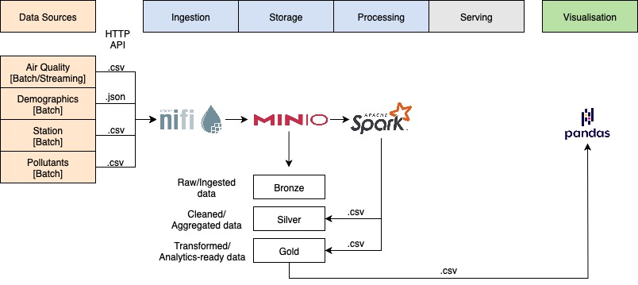
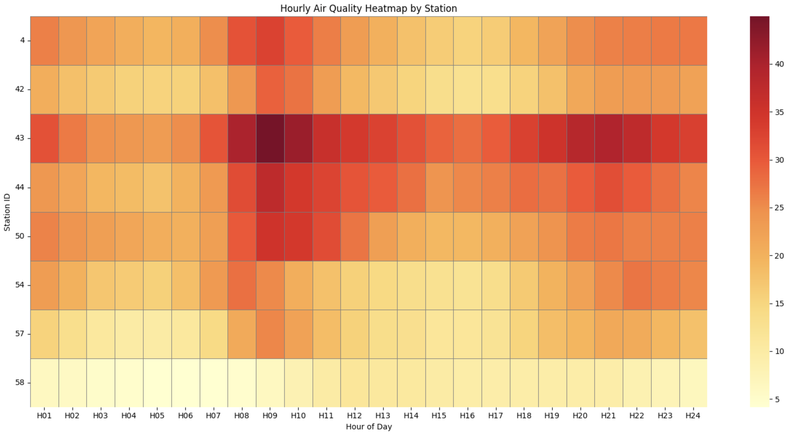
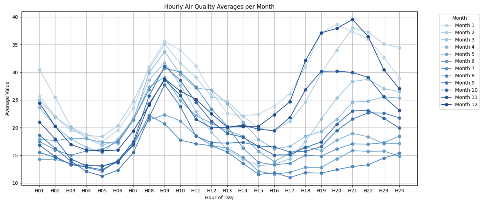
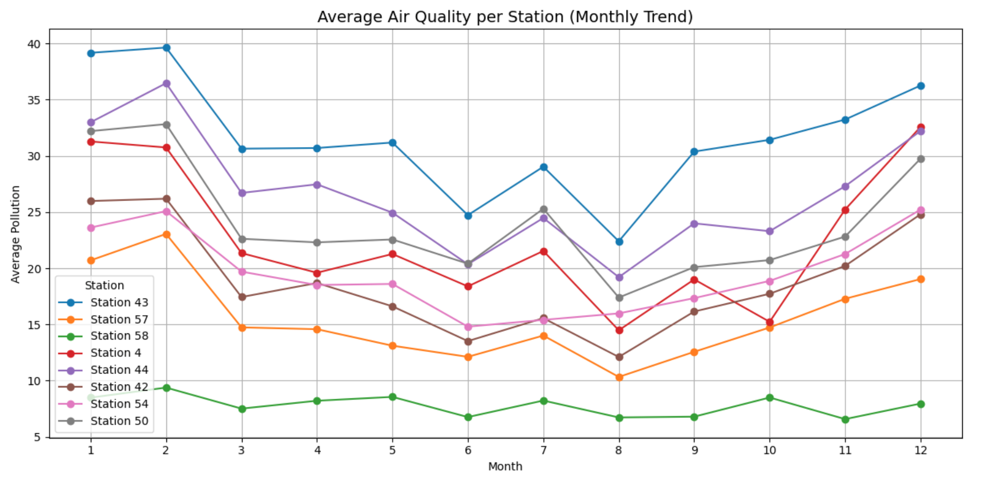

# Barcelona Air Quality: Big Data Pipeline

**Resilient cities start with data.** A pilot for mapping NO₂ exposure risk in Barcelona. Open data on air quality, monitoring stations and demographics is ingested with **Apache NiFi**, stored in a **MinIO** data lake in bronze, silver and gold layers, and cleaned and joined with **PySpark** to answer three questions:

1. When during the day and year is NO₂ highest?
2. Which areas of Barcelona are hit hardest?
3. Which districts combine high exposure with vulnerable age groups?

`Apache NiFi` · `MinIO (S3)` · `PySpark` · `pandas` · `matplotlib / seaborn` · `Barcelona Open Data`



## Pipeline

| Layer | What happens |
|---|---|
| **Ingestion** | A NiFi flow ([`nifi/air_quality_ingestion.json`](nifi/air_quality_ingestion.json)) calls the Barcelona Open Data API for air quality, stations, pollutants and demographics, and writes the raw files to MinIO. |
| **Bronze** | Raw CSV/JSON in the `raw-bcn-airquality` bucket. |
| **Silver** | Spark merges the monthly files into one dataset and drops rows with less than 50% validated measurements. It keeps NO₂ only (pollutant code 8), turns `"NA"` into nulls and builds a proper date column. |
| **Gold** | Daily averages from 24 hourly readings, joined with station locations and district age-group data, ready for analysis. |
| **Serving** | Charts in pandas and seaborn; the combined dataset is written back to MinIO. |

## Findings



- **Eixample (station 43, urban traffic)** has the highest NO₂ levels at almost every hour, peaking around **9:00**. Gràcia (44) and Ciutat Vella (50) follow.
- Every station shows a **morning rush-hour peak (8–10h)** and a second, broader **evening peak (19–22h)**, which points to road traffic as the main source.
- **Sarrià-Sant Gervasi (58, suburban)** stays clean all day.
- Overlaying district age structure identifies where high exposure meets older or younger residents. That is where health interventions would help most.

<p>


</p>

## Repository layout

```
nifi/            NiFi flow definition (import as a template)
notebooks/       PySpark processing and analysis (air_quality_pipeline.ipynb)
architecture/    architecture diagram (.jpg + editable .drawio)
results/         charts
reports/         final presentation (PDF)
```

## Running it

Built on the OSBDET big-data VM (NiFi, MinIO and Jupyter with PySpark on localhost).

1. Create the MinIO bucket `raw-bcn-airquality`.
2. Import and run the NiFi flow to pull the open data into MinIO.
3. Set the MinIO credentials and run the notebook:
   ```bash
   export MINIO_ACCESS_KEY=...
   export MINIO_SECRET_KEY=...
   jupyter notebook notebooks/air_quality_pipeline.ipynb
   ```

## Context

Group project for *Modern Data Architecture for Big Data I*, Master in Business Analytics & Data Science, IE University (2025).
Data: [Barcelona Open Data](https://opendata-ajuntament.barcelona.cat).
